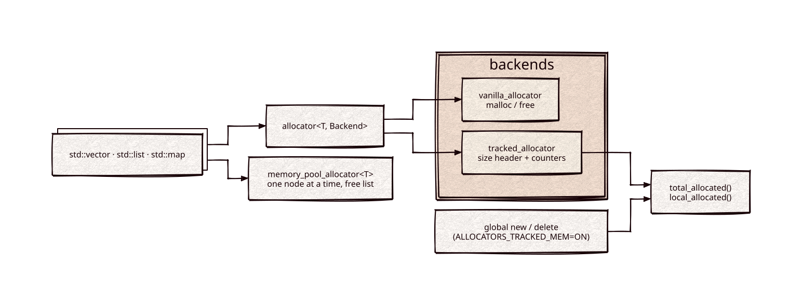

# allocators

Part of [Kronuz C++ Libraries](https://github.com/Kronuz/cpp-libraries), a collection of small, reusable C++ libraries.

[](https://github.com/Kronuz/allocators/actions/workflows/ci.yml)
[](LICENSE)


A small allocation toolkit for C++20: an STL allocator over pluggable backends,
a one-node-at-a-time memory pool, and optional accounting of every heap byte in
the process. For finding out where memory goes, and for node-heavy containers.



## ✨ Highlights

- **`allocator<T, Backend>`**, standard-conforming, over `vanilla_allocator`
  (`malloc`/`free`) or `tracked_allocator` (byte accounting).
- **`memory_pool_allocator<T>`** for `std::list`, `std::map`, and other node
  containers: one element at a time, freed slots reused.
- **Whole-process accounting**, opt-in: `ALLOCATORS_TRACKED_MEM=ON` overrides the
  global `new`/`delete`, and `total_allocated()` and `local_allocated()` report
  live bytes for the process and the calling thread.
- **No dependencies.**

## 📦 Installation

Requires a C++20 compiler and CMake 3.14 or newer; it compiles one source file.
CI builds it on Linux (x86_64, arm64), macOS (arm64, x86_64), and FreeBSD, plus
ASan, UBSan, and TSan builds.

```cmake
include(FetchContent)
FetchContent_Declare(allocators
  GIT_REPOSITORY https://github.com/Kronuz/allocators.git
  GIT_TAG        main)
# set(ALLOCATORS_TRACKED_MEM ON CACHE BOOL "" FORCE)   # opt in to global accounting
FetchContent_MakeAvailable(allocators)

target_link_libraries(my_app PRIVATE allocators::allocators)
```

## 🚀 Quick start

```cpp
#include "allocators.h"

#include <cstdio>
#include <list>

int main() {
	std::list<int, allocators::memory_pool_allocator<int>> nodes{1, 2, 3};

	long long before = allocators::total_allocated();
	auto* buffer = new char[1024];
	std::printf("%lld bytes\n", allocators::total_allocated() - before);   // >= 1024 when tracking
	delete[] buffer;
}
```

Without `ALLOCATORS_TRACKED_MEM`, the counters read `0`.

### Construction forwards its arguments

`construct(p, args...)` of both allocators perfect-forwards to the element constructor, so a
container relocating through `allocator_traits::construct(a, p, std::move(x))` moves, and a
throwing move falls back to a copy, exactly as with `std::allocator`. A `construct(p, const T&)`
overload copies instead: a `vector` filled by 1000 `push_back(T&&)`s then makes 2023 copies and no
moves (`std::allocator`: no copies, 2023 moves), a deep copy of every `std::string` element.
`test/construct.cc` compares copy, move and destroy counts with `std::allocator` for `vector`,
`deque`, `list`, `map`, `unordered_map` and a type whose copies and moves throw. `allocators_bench`
times `vector<int>` and `vector<std::string>` `push_back` against `std::allocator` (A/B/A, best of 11);
`allocators_bench --counts` prints only the counts. [docs/perf/construct-forwarding.md](docs/perf/construct-forwarding.md)
has the timings, the mutants and the platforms.

### The memory pool: identity and threads

All copies and rebinds of a `memory_pool_allocator` share one pool, so
`A<T>(A<U>(a)) == a` and allocators of one pool compare equal whatever their value types. The
converting constructor never allocates. A container *copy* gets its own pool: copy construction
takes a new one (`select_on_container_copy_construction`), and copy assignment keeps the
target's allocator (`propagate_on_container_copy_assignment` is `false_type`), so the copied
elements are allocated from the target's pool. Move assignment and swap hand the nodes over
together with the pool (`propagate_on_container_move_assignment` and `_swap` are `true_type`),
and `is_always_equal` is `false_type`.

A move copies the allocator, so a moved-from container keeps sharing the pool with the
container that took its nodes. Use the pair as one unit, or give the moved-from one a pool of
its own before another thread touches either: move-assign a fresh container to it (`a = C{}`)
or swap it with one. Copy assignment (`a = fresh`), `a = {}` and `clear()` look like resets and
are not: the container keeps the shared pool. Moving a container to another thread is safe
when its source is not used again or is re-pooled first.

Containers with separate pools compare unequal, such as a copy and its source (including after
a copy assignment, which keeps the target's pool). `splice` and `merge` between them are not
allowed, because the standard requires equal allocators. Containers that share a pool, such as
a moved-from container and the one that took its nodes, can splice and merge.

**A pool is not thread-safe**: use all allocators of one pool from one thread at a time,
with a happens-before edge at each hand-over. Copying a container to another thread is
safe (the copy is independent); sharing an allocator, or using a container from two threads,
is not. Without `NDEBUG` (or with `ALLOCATORS_POOL_CHECK`) overlapping use is detected and
reported through `allocators::set_pool_misuse_handler` (abort by default).

## Bounded resources and cleanup

`allocators::resources` is a separate header-only target for explicit ownership and resource limits. It neither builds nor links the legacy allocator backends or global allocation overrides. `allocators::retirement` adds a caller-owned POSIX cleanup runtime; disable its target with `ALLOCATORS_BUILD_RETIREMENT=OFF` when only accounting is needed. The compiled target follows `BUILD_SHARED_LIBS`, like the legacy allocator target.

```cpp
#include <allocators/memory_resource.h>
#include <allocators/allocation.h>

// Charge the complete upstream allocation, including headers and alignment.
auto account = std::make_shared<allocators::ByteAccount>(1024 * 1024);
auto resource = allocators::make_charged_resource(account);
auto value = std::allocate_shared<int>(
    allocators::OwnedAllocator<int>(allocators::AllocationContext(resource)), 42);
```

A `ByteCharge` retains the account's counter state, including its ancestors, after the initiating facade is destroyed. Successful admission and release allocate no bookkeeping storage; constructing an independent account allocates its counter state once, outside its own payload quota. Pressure rolls back all ancestor charges before throwing `ResourcePressure`. `PagedStorage` also retains state and can continue allocating after the initiating facade is gone.

```cpp
#include <allocators/resources.h>

// Reserve simultaneous peak effects before beginning an external operation.
using Vector = allocators::ResourceVector<2>;
allocators::ReservationBook<2> book(Vector{{1000, 10}}, Vector{{200, 2}});
auto reservation = book.try_reserve(Vector{{300, 3}}, Vector{{800, 8}});
if (reservation) {
    book.settle(*reservation, Vector{{250, 2}}, Vector{{100, 1}});
}
```

Reservation books belong to one executor and outlive their move-only capabilities. Destroying an unresolved reservation preserves its debt and marks abandonment; only explicit cancellation or settlement releases reserved capacity. The caller proves reclaim credits and enforces protected pools, original-I/O ownership and durable deletion. Those policies are outside the shared arithmetic.

```cpp
#include <allocators/retirement.h>

// Final owner release enqueues cleanup; the application owns shutdown.
auto baseline = std::make_shared<allocators::ByteAccount>(1024 * 1024);
auto objects = std::make_shared<allocators::ByteAccount>(1024 * 1024);
allocators::RetirementRuntime runtime(baseline);
auto domain = runtime.domain(objects);
auto drain = domain.close();
drain.wait();
runtime.shutdown();
```

Retirement handles release through an intrusive queue. Payload destruction and control-block release run on the fixed cleanup worker. Keep the runtime alive until every domain drains, and retain accepted I/O owners until authentic completion before retiring them.

## 📊 Performance

`allocators_compare_pmr` times the memory pool against `std::allocator` (malloc) and the standard library's `std::pmr` resources. It needs only the standard library:

```sh
cmake -B build -DCMAKE_BUILD_TYPE=Release -DALLOCATORS_BUILD_BENCH=ON
cmake --build build --target allocators_compare_pmr && ./build/allocators_compare_pmr
```

A run builds a container, works it and destroys it, with a fresh pool or resource each time, so creating the pool is in the time. The table gives each arm's time as a fraction of `std::allocator`'s (median of 9 rounds; the A/A copy of the malloc arm is within 1%; round spreads are 1.01 to 1.33). Release, Apple clang 17 with libc++, on an Apple M4 Pro and an Intel Core i9-9980HK.

| Row | pool, M4 Pro | `pmr` pool, M4 Pro | pool, i9 | `pmr` pool, i9 |
|---|---|---|---|---|
| list build, 1,000 nodes | 0.70 | 0.50 | 0.65 | 0.24 |
| list build, 100,000 nodes | 0.58 | 0.34 | 0.68 | 0.27 |
| map churn, 1,000 nodes | 0.56 | 0.68 | 0.57 | 0.65 |
| map churn, 100,000 nodes | 0.82 | 0.99 | 0.81 | 0.92 |
| list steady, 1,000 nodes | 0.61 | 0.32 | 0.70 | 0.20 |
| list steady, 100,000 nodes | 0.56 | 0.30 | 0.70 | 0.20 |

`pmr::monotonic_buffer_resource`, which never frees, builds a list in 0.26 to 0.27 (M4 Pro) and 0.13 to 0.21 (i9) of malloc's time. The pool is faster than `pmr::unsynchronized_pool_resource` on map churn and slower on lists. The rows are `list<int>` (build, sum, destroy; and 20 n `push_back` and `pop_front` pairs for steady) and `map<int, int>` (n random inserts, erase the n/2 smallest, n/2 more inserts).

## 🎯 When to use it

- ✅ Measuring heap use in tests, benchmarks, or a debug build of a service.
- ✅ Node-based containers that allocate one element at a time.
- ⚠️ Tracking overrides the global `operator new` for the whole program; turn it
  on in the executable's build, not from a library.
- ❌ A general-purpose faster `malloc`: use jemalloc or mimalloc.

## 📚 Documentation

- [docs/API.md](docs/API.md): usage of each allocator and the tracking build
  option.
- [ARCHITECTURE.md](ARCHITECTURE.md): the size headers, the counters, and the
  pool.
- [examples/demo.cc](examples/demo.cc): the counters in action.
- [AGENTS.md](AGENTS.md): repository map, invariants, and traps.
- [CHANGELOG.md](CHANGELOG.md): behavior changes, newest first.

## 🛠️ Building and testing

```sh
cmake -B build && cmake --build build && ctest --test-dir build
cmake -B build-tracked -DALLOCATORS_TRACKED_MEM=ON && cmake --build build-tracked && ctest --test-dir build-tracked
```

The same test checks whichever contract the build has.

## 🤝 Contributing

Issues and pull requests are welcome. Read [AGENTS.md](AGENTS.md) first. CI must
pass on every platform.

## 📄 License

MIT, Copyright (c) 2015-2018 Dubalu LLC; the memory pool carries a BSD-2-Clause
notice from moya-lang.org. See [LICENSE](LICENSE). Extracted from
[Xapiand](https://github.com/Kronuz/Xapiand).
